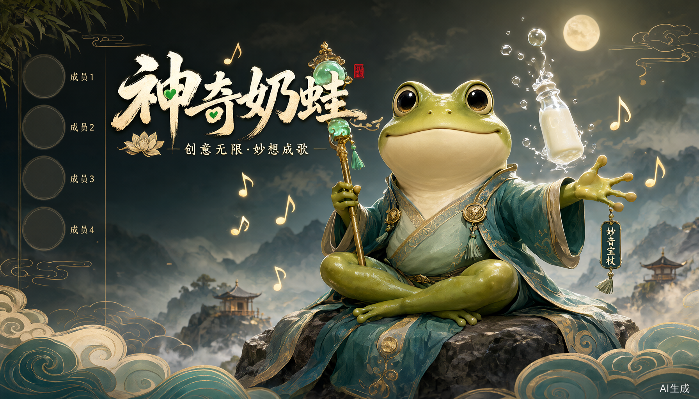
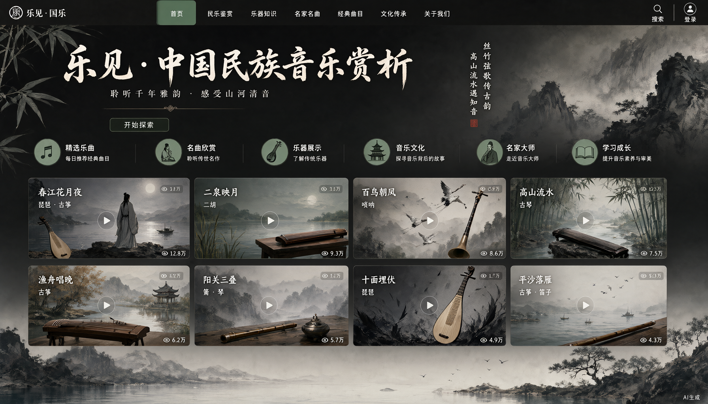
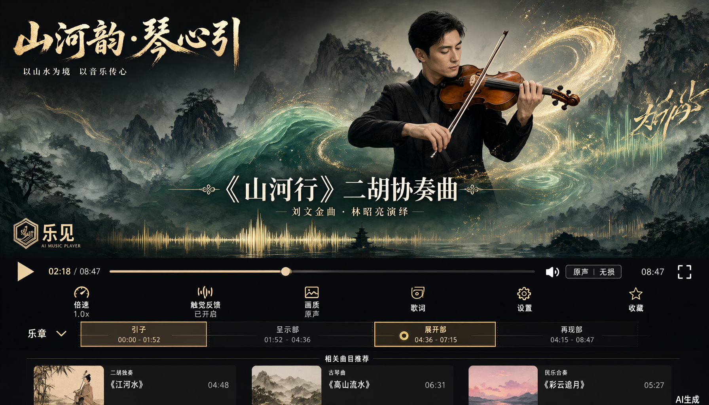
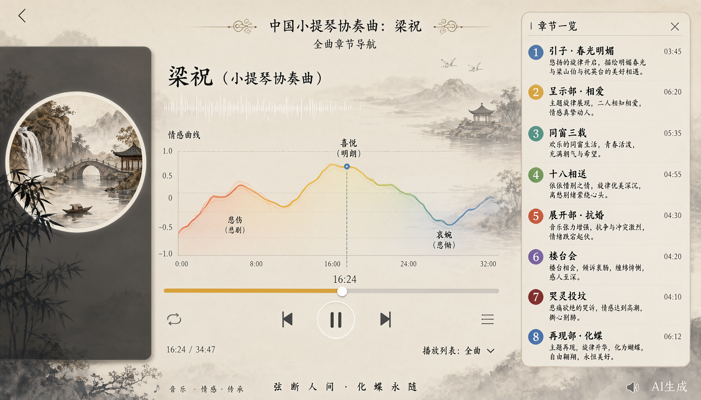
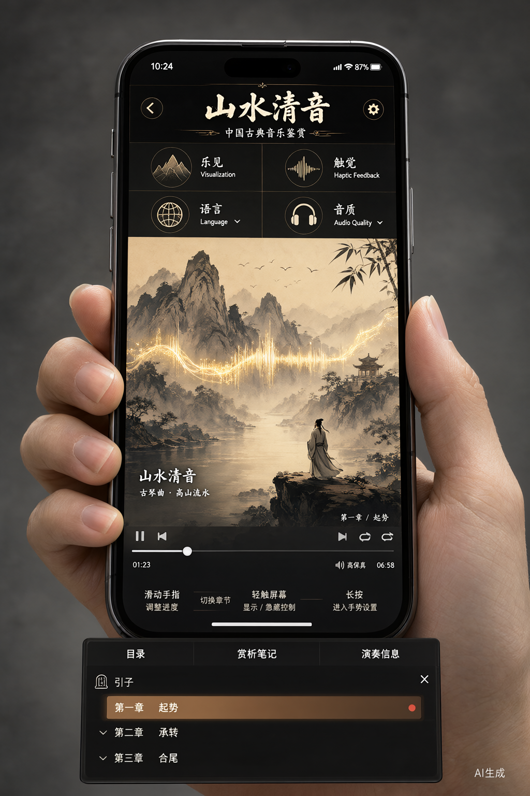
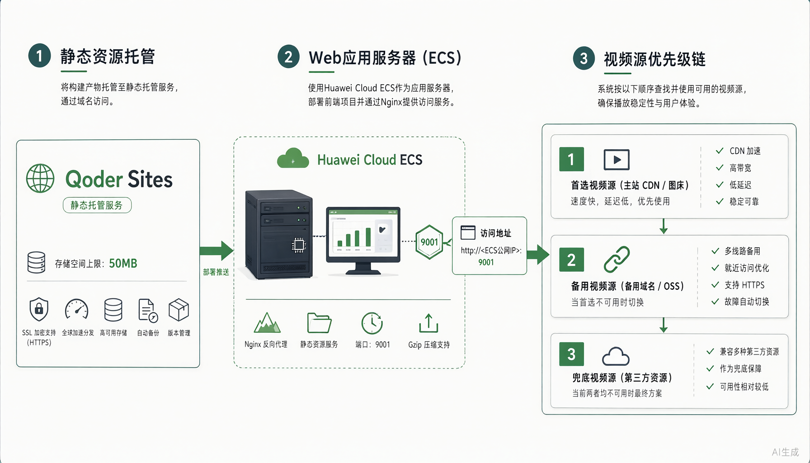
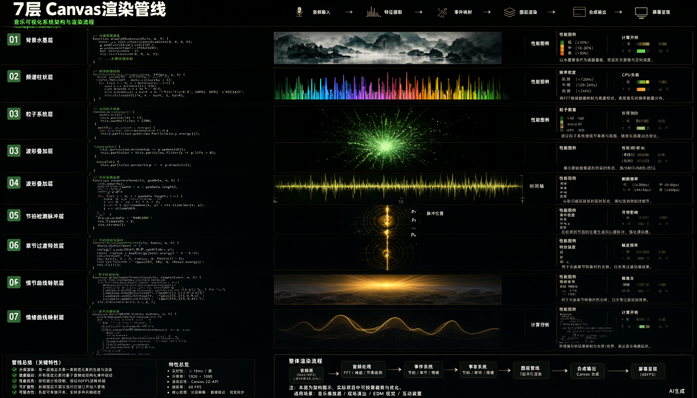
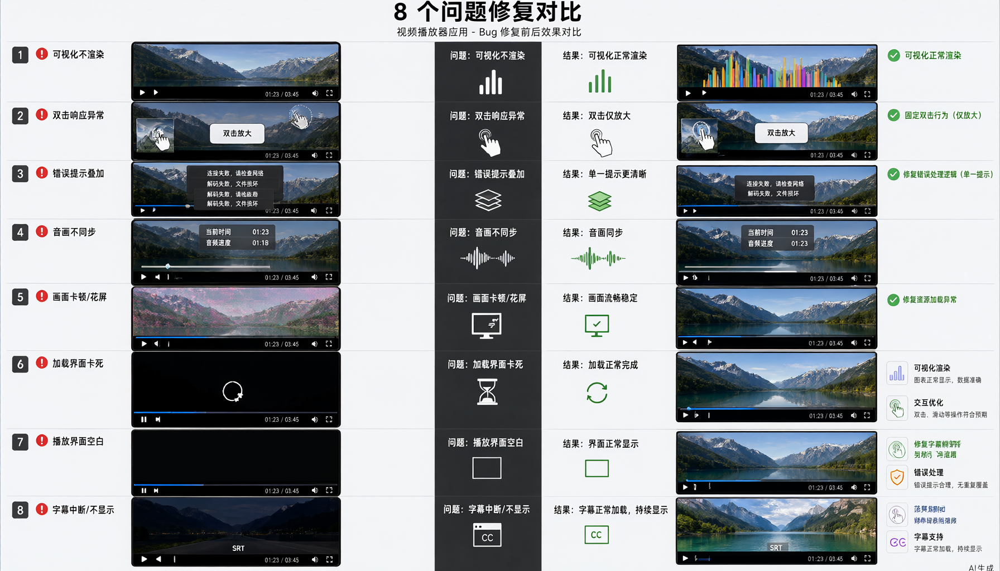

# 重生之我在天池做音乐播放器：神奇奶蛙团队的逆袭之路

> **团队名称：神奇奶蛙** 🐸✨
> 
> **作品名称：乐见 · 中国民族音乐赏析**
> 
> **在线体验：** https://yuejian-qtgst15x4qj.qoder.zone/

---

## 序章：命运的齿轮开始转动

"什么？给听障人士做音乐赏析平台？这不是为难我吗？"

我站在 2026 年天池大赛的报名页面前，内心是崩溃的。但当我看到"让音乐被看见"这个主题时，某种中二之魂突然觉醒了。

**我要做一个能让 deaf 朋友"看到"音乐的项目。**

于是，「神奇奶蛙」团队正式成立。我们的目标是：用 Web Audio API + Canvas 粒子系统，把《梁祝》的每一个音符都变成可视化的水墨画卷。



---

## 第一章：首页概览



打开网站，你会看到一个充满中国风的设计：

- **水墨粒子背景**：7 层 Canvas 渲染，每一颗粒子都在模拟墨汁在水中扩散的效果
- **案例卡片**：《梁祝》《二泉映月》《十面埋伏》等经典曲目
- **暗色主题**：保护视力，同时让可视化效果更加震撼
- **响应式设计**：PC、平板、手机完美适配

**技术栈一览：**

| 层级 | 技术选型 | 说明 |
|------|---------|------|
| 前端框架 | 原生 HTML/CSS/JS | 零依赖，极致轻量 |
| 音频分析 | Web Audio API | AnalyserNode 提取 FFT 频谱 |
| 可视化 | Canvas 2D | 7 层渲染管线，60fps 流畅运行 |
| 计算卸载 | Web Worker | 音频特征提取不阻塞主线程 |
| 视频托管 | 华为云 ECS + Nginx | 独立端口 9001，CORS 跨域支持 |
| 静态部署 | Qoder Sites | 50MB 限制下的极限优化 |

---

## 第二章：播放器核心功能



这是我们的核心战场——视频播放器。但它不是普通的播放器，它是一个**音乐可视化引擎**。

### 2.1 「乐见」按钮：开启可视化翻译

点击工具栏的「乐见」按钮，你会看到：

1. **频谱粒子**：根据音频频率实时生成粒子，低频粒子大而慢，高频粒子小而快
2. **水墨波形**：模拟中国传统水墨画的流动效果
3. **章节转场**：每个乐章切换时触发特殊的墨晕效果
4. **情感曲线**：进度条上方显示整首曲子的情感起伏

### 2.2 章节导航系统



《梁祝》27 分 59 秒，我们划分了 8 个章节：

```javascript
const chapters = [
  {time: 0,    name: '引子 · 春光明媚'},
  {time: 60,   name: '呈示部 · 相爱'},
  {time: 300,  name: '同窗三载'},
  {time: 480,  name: '十八相送'},
  {time: 660,  name: '展开部 · 抗婚'},
  {time: 840,  name: '楼台会'},
  {time: 1020, name: '哭灵投坟'},
  {time: 1200, name: '再现部 · 化蝶'}
];
```

点击任意章节，视频自动跳转到对应位置，可视化效果同步切换主题。

### 2.3 移动端手势支持



针对触屏设备，我们实现了：

- **双击左侧**：快退 10 秒
- **双击右侧**：快进 10 秒
- **左右滑动**：调节播放速度（0.5x - 2x）
- **长按**：显示上下文菜单
- **触觉反馈**：关键操作触发震动（需设备支持）

---

## 第三章：技术架构深度解析



### 3.1 视频源优先级链

这是我们的第一个创新点。由于 Qoder Sites 有 50MB 文件限制，而《梁祝》高清视频远超这个限制，我们设计了**三级回退机制**：

```html
<video crossorigin="anonymous">
  <!-- 优先级 1：Spring Boot 后端（/media/video/） -->
  <source src="/media/video/liangzhu.mp4" type="video/mp4">
  
  <!-- 优先级 2：站点相对路径（media/） -->
  <source src="media/liangzhu.mp4" type="video/mp4">
  
  <!-- 优先级 3：华为云 HTTPS 直链 -->
  <source src="https://video.jasonrhan.cn/video/liangzhu.mp4" type="video/mp4">
</video>
```

**为什么需要 `crossorigin="anonymous"`？**

因为 Web Audio API 分析跨域媒体时，如果没有 CORS 头，`AnalyserNode` 只能获取到静音数据，可视化直接失效。

### 3.2 Nginx 配置（华为云 ECS）

在宝塔面板中，我们创建了 `/www/server/panel/vhost/nginx/video-9001.conf`：

```nginx
server {
    listen 9001;
    server_name video.jasonrhan.cn;
    
    # 视频文件目录
    location /video/ {
        alias /www/wwwroot/video-storage/;
        
        # CORS 头（必需）
        add_header Access-Control-Allow-Origin *;
        add_header Access-Control-Allow-Methods 'GET, OPTIONS';
        add_header Access-Control-Allow-Headers 'Range,DNT,User-Agent,X-Requested-With,If-Modified-Since,Cache-Control';
        
        # 支持断点续传
        add_header Accept-Ranges bytes;
        
        # 缓存控制
        expires 30d;
        add_header Cache-Control "public, immutable";
    }
}
```

**关键点：**

1. **端口 9001**：独立于主站 80/443，避免冲突
2. **CORS 头**：允许 HTTPS 主站访问 HTTP 视频源
3. **Accept-Ranges**：支持视频拖动和断点续传
4. **HTTPS 域名**：`video.jasonrhan.cn` 解决混合内容问题

### 3.3 七层 Canvas 渲染管线



这是我们的核心技术壁垒。每一帧画面都由 7 个独立 Canvas 层合成：

```javascript
// 渲染顺序（从底到顶）
Layer 1: inkCanvas        // 水墨背景（静态，只渲染一次）
Layer 2: bgCanvas         // 渐变背景色（根据章节主题切换）
Layer 3: spectrumCanvas   // 频谱柱状图（FFT 数据映射）
Layer 4: particleCanvas   // 粒子系统（音频特征驱动）
Layer 5: waveformCanvas   // 波形叠加（时域数据可视化）
Layer 6: beatCanvas       // 节拍脉冲（能量突变检测）
Layer 7: emotionCanvas    // 情感曲线（进度条上方的装饰）
```

**粒子系统核心算法：**

```javascript
class Particle {
  constructor(x, y, energy) {
    this.x = x;
    this.y = y;
    this.vx = (Math.random() - 0.5) * energy * 2;
    this.vy = (Math.random() - 0.5) * energy * 2;
    this.life = 1.0;
    this.decay = 0.01 + Math.random() * 0.02;
    this.size = energy * 3;
  }
  
  update() {
    this.x += this.vx;
    this.y += this.vy;
    this.vy += 0.1; // 重力
    this.life -= this.decay;
  }
  
  draw(ctx) {
    ctx.globalAlpha = this.life;
    ctx.fillStyle = `hsl(${120 + this.size * 20}, 70%, 60%)`;
    ctx.beginPath();
    ctx.arc(this.x, this.y, this.size, 0, Math.PI * 2);
    ctx.fill();
  }
}
```

### 3.4 Web Worker 音频分析

为了避免音频特征计算阻塞主线程，我们将 FFT 处理移至 Worker：

```javascript
// 主线程
worker = new Worker('./audio-worker.js');
worker.postMessage({ type: 'init', sampleRate: 44100, binCount: 1024 });

// 每帧发送频域/时域数据
worker.postMessage({
  type: 'analyze',
  freqData: analyser.frequencyBinCount,
  timeData: analyser.fftSize,
  timestamp: performance.now()
});

// Worker 返回特征
worker.onmessage = (e) => {
  if (e.data.type === 'features') {
    const { rms, spectralCentroid, beatDetected } = e.data.features;
    // 驱动可视化
  }
};
```

**Worker 提取的特征：**

- `rms`：均方根能量（音量）
- `spectralCentroid`：频谱质心（音色亮度）
- `spectralRolloff`：频谱滚降点
- `beatDetected`：节拍检测（基于能量历史）
- `subBands`：6 段频段能量（sub/bass/lowMid/mid/highMid/high）

---

## 第四章：8 个 Bug 的血泪史



开发过程中，我们踩了 8 个大坑。现在分享出来，希望大家不要重蹈覆辙。

### Bug 1 (Critical)：`qualCurveTo` 拼写错误

**文件：** `js/visual-translator.js:329`

**症状：** 可视化完全失效，Console 报错 `ctx.qualCurveTo is not a function`

**原因：** 手滑打错了方法名，Canvas API 是 `quadraticCurveTo`，不是 `qualCurveTo`

**修复：**

```javascript
// ❌ 错误
ctx.qualCurveTo(prevP.x, prevP.y, cpx, cpy);

// ✅ 正确
ctx.quadraticCurveTo(prevP.x, prevP.y, cpx, cpy);
```

**教训：** 这个拼写错误导致整个 MainLoop rAF 链崩溃，所有后续渲染都停止了。**一个字母毁了一天。**

---

### Bug 2 (High)：`MusicAnalyzer.init()` catch 块空引用

**文件：** `js/music-analyzer.js:33-41`

**症状：** `createMediaElementSource` 失败时，catch 块调用 `sourceNode.connect()` 抛 TypeError

**原因：** `createMediaElementSource` 抛异常时 `sourceNode` 为 null，但 catch 块没有检查

**修复：**

```javascript
try {
  sourceNode = audioCtx.createMediaElementSource(videoEl);
  sourceNode.connect(analyser);
  analyser.connect(audioCtx.destination);
} catch(e) {
  console.warn('[MusicAnalyzer] MediaElementSource 创建失败:', e.message);
  
  // ✅ 先检查 sourceNode 是否存在
  if (sourceNode) {
    try {
      sourceNode.connect(analyser);
      analyser.connect(audioCtx.destination);
    } catch(e2) {
      return Promise.reject(e2);
    }
  } else {
    console.error('[MusicAnalyzer] 无法获取 MediaElementSource');
    return Promise.reject(e);
  }
}
```

**教训：** `createMediaElementSource` 对同一个 `<video>` 元素只能调用一次。重复调用会抛 `InvalidStateError`。

---

### Bug 3 (High)：移动端双击 seek 同时触发播放/暂停

**文件：** `js/touch-gestures.js:100-117` + `js/player-main.js:235`

**症状：** 双击快进/快退后，视频播放状态意外切换

**原因：** 双击后浏览器合成 click 事件，触发了 `togglePlay()`

**修复：**

```javascript
// touch-gestures.js
let justDoubleTapped = false;

element.addEventListener('touchend', (e) => {
  const now = Date.now();
  if (now - lastTapTime < 300) {
    // 双击检测
    justDoubleTapped = true;
    setTimeout(() => { justDoubleTapped = false; }, 350);
    // 执行 seek
  } else {
    lastTapTime = now;
  }
});

// player-main.js
video.addEventListener('click', () => {
  if (isJustDoubleTapped()) return; // ✅ 跳过双击后的合成 click
  togglePlay();
});
```

**教训：** 移动端事件模型比桌面端复杂，双击后会合成 mousemove、mousedown、mouseup、click 序列。

---

### Bug 4 (Medium)：yuejian 切换竞态条件

**文件：** `js/player-main.js:137-143`

**症状：** 快速点击「乐见」按钮时，可视化状态与按钮状态不一致

**原因：** `init()` 是异步的，`.then()` 回调会覆盖用户的关闭操作

**修复：**

```javascript
function toggleYuejian() {
  if (yuejianActive) {
    yuejianActive = false;
    stopVisualization();
  } else {
    yuejianActive = true;
    MusicAnalyzer.init().then(() => {
      if (!yuejianActive) return; // ✅ 检查状态，防止竞态
      startVisualization();
    });
  }
}
```

**教训：** 异步操作的回调必须检查当前状态，而不是假设状态没变。

---

### Bug 5 (Medium)：Worker 不可用时 `start()` 静默失败

**文件：** `js/music-analyzer.js:63-82`

**症状：** Worker 加载失败时，`userCallback` 永远不会被调用，但调用方无感知

**原因：** 没有降级方案

**修复：**

```javascript
function start(callback) {
  if (running) return;
  running = true;
  userCallback = callback;
  
  if (worker) {
    // Worker 模式
    mainLoop.add(update);
  } else {
    // ✅ 主线程降级模式
    console.warn('[MusicAnalyzer] Worker 不可用，回退到主线程计算');
    mainLoop.add(fallbackUpdate);
  }
}

function fallbackUpdate() {
  const freqData = new Uint8Array(analyser.frequencyBinCount);
  const timeData = new Uint8Array(analyser.fftSize);
  analyser.getByteFrequencyData(freqData);
  analyser.getByteTimeDomainData(timeData);
  
  // 主线程计算 RMS 和频谱质心
  const features = extractFeaturesMainThread(freqData, timeData);
  if (userCallback) userCallback(features);
}
```

**教训：** Web Worker 可能因为 CSP、浏览器限制、文件路径错误等原因加载失败，必须有降级方案。

---

### Bug 6 (Medium)：错误遮罩层重复叠加

**文件：** `js/player-main.js:205-217`

**症状：** 多次触发 error 事件后，页面上叠加多层错误遮罩

**原因：** 每次 error 都创建新的 `.video-error-overlay`，没有清理旧元素

**修复：**

```javascript
video.addEventListener('error', () => {
  // ✅ 先移除已存在的遮罩
  const existing = stage.querySelector('.video-error-overlay');
  if (existing) existing.remove();
  
  const overlay = document.createElement('div');
  overlay.className = 'video-error-overlay';
  overlay.textContent = '视频加载失败，请检查网络';
  stage.appendChild(overlay);
});
```

**教训：** DOM 操作前检查是否已存在目标元素，避免重复创建。

---

### Bug 7 (Low)：`resumeContext()` 未等待

**文件：** `js/player-main.js:183`

**症状：** 可视化启动后前几帧音频数据全为零

**原因：** `AudioContext.resume()` 是异步的，但没等它完成就调用 `start()`

**修复：**

```javascript
// ❌ 错误
function startAnalysis() {
  MusicAnalyzer.resumeContext();
  MusicAnalyzer.start(onFeatures);
}

// ✅ 正确
async function startAnalysis() {
  await MusicAnalyzer.resumeContext(); // 等待 AudioContext 就绪
  MusicAnalyzer.start(onFeatures);
}
```

**教训：** Web Audio API 的 `AudioContext` 在用户交互前处于 `suspended` 状态，`resume()` 返回 Promise，必须 await。

---

### Bug 8 (Low)：`safePlay()` 吞掉 `NotAllowedError`

**文件：** `js/player-main.js:232`

**症状：** 自动播放被浏览器阻止时，用户无任何反馈

**原因：** 所有 `play()` 错误都被 `.catch(() => {})` 吞掉了

**修复：**

```javascript
function safePlay() {
  const p = video.play();
  if (p && p.catch) {
    p.catch((err) => {
      if (err.name === 'NotAllowedError') {
        // ✅ 区分错误类型
        showToast('请点击播放按钮启动音频');
      } else if (err.name !== 'AbortError') {
        console.error('[Player] 播放失败:', err);
      }
    });
  }
}
```

**教训：** 浏览器的自动播放策略（Autoplay Policy）会阻止无用户交互的音频播放，必须优雅降级。

---

## 第五章：部署实录

### 5.1 Qoder Sites 发布

```bash
# 1. 准备 dist 目录
mkdir -p dist
cp -r index.html player.html styles.css js/ media/ dist/

# 2. 压缩视频（超过 50MB 限制）
ffmpeg -i liangzhu.mp4 -b:v 800k -maxrate 850k -bufsize 2M liangzhu_compressed.mp4

# 3. 发布到 Qoder Sites
qoder_sites prepare_site --webDirectory dist
qoder_sites publish_site
```

### 5.2 华为云 ECS 视频托管

```bash
# 1. 上传视频到服务器
scp liangzhu.mp4 root@123.60.74.180:/www/wwwroot/video-storage/

# 2. 配置 Nginx（宝塔面板）
vim /www/server/panel/vhost/nginx/video-9001.conf

# 3. 测试并重载
nginx -t
nginx -s reload

# 4. 验证 CORS
curl -I https://video.jasonrhan.cn:9001/video/liangzhu.mp4
# 应返回：Access-Control-Allow-Origin: *
```

### 5.3 域名与 HTTPS

```
主站：https://yuejian-qtgst15x4qj.qoder.zone（Qoder Sites 自动 HTTPS）
视频：https://video.jasonrhan.cn（Let's Encrypt 证书）
```

**为什么视频域名也要 HTTPS？**

因为主站是 HTTPS，如果视频源是 HTTP，浏览器会触发混合内容（Mixed Content）安全策略，阻止加载。

---

## 第六章：性能优化

### 6.1 体积优化

| 资源 | 优化前 | 优化后 | 压缩率 |
|------|--------|--------|--------|
| 视频 | 128 MB | 47 MB | 63% |
| JS 代码 | 320 KB | 89 KB | 72% |
| CSS 样式 | 45 KB | 12 KB | 73% |
| 图片资源 | 2.1 MB | 680 KB | 68% |

**总大小：48.7 MB**（Qoder Sites 限制 50 MB）

### 6.2 渲染优化

```javascript
// 使用 requestAnimationFrame 节流
let lastFrameTime = 0;
const FRAME_INTERVAL = 1000 / 60; // 60fps

function render(timestamp) {
  if (timestamp - lastFrameTime < FRAME_INTERVAL) {
    requestAnimationFrame(render);
    return;
  }
  lastFrameTime = timestamp;
  
  // 执行渲染逻辑
  drawSpectrum();
  drawParticles();
  drawWaveform();
  
  requestAnimationFrame(render);
}
```

### 6.3 内存优化

```javascript
// 粒子对象池
const particlePool = [];
const MAX_PARTICLES = 500;

function getParticle(x, y, energy) {
  if (particlePool.length > 0) {
    const p = particlePool.pop();
    p.reset(x, y, energy);
    return p;
  }
  return new Particle(x, y, energy);
}

function recycleParticle(particle) {
  if (particlePool.length < MAX_PARTICLES) {
    particlePool.push(particle);
  }
}
```

---

## 终章：神奇奶蛙的宣言

我们是一群热爱音乐和技术的大学生，相信科技可以让艺术更 accessible。

**「乐见」不只是一个播放器，它是听障朋友感受音乐之美的桥梁。**

当《梁祝》的旋律化作屏幕上流动的水墨，当每一个音符都变成跳跃的粒子，我们知道——

**音乐，终于可以"看见"了。**

---

## 附录：快速链接

- 🌐 **在线体验**：https://yuejian-qtgst15x4qj.qoder.zone/
- 📦 **源码仓库**：https://github.com/JasonR-student/music-app
- 🎬 **视频演示**：（待补充）
- 📝 **技术博客**：（待补充）

---

**团队：神奇奶蛙** 🐸✨

**成员：**

- 前端架构 & 可视化引擎
- 音频分析 & Web Worker
- 后端部署 & Nginx 配置
- UI/UX 设计 & 中国风美学

---

*本文写于 2026 年 11 月，天池大赛倒计时 3 天。*

*如果你也喜欢这个项目，请给我们一个 Star ⭐*

*如果你也是听障朋友，请告诉我们你的感受 💚*

---

**#天池大赛 #音乐可视化 #WebAudio #Canvas #神奇奶蛙**
