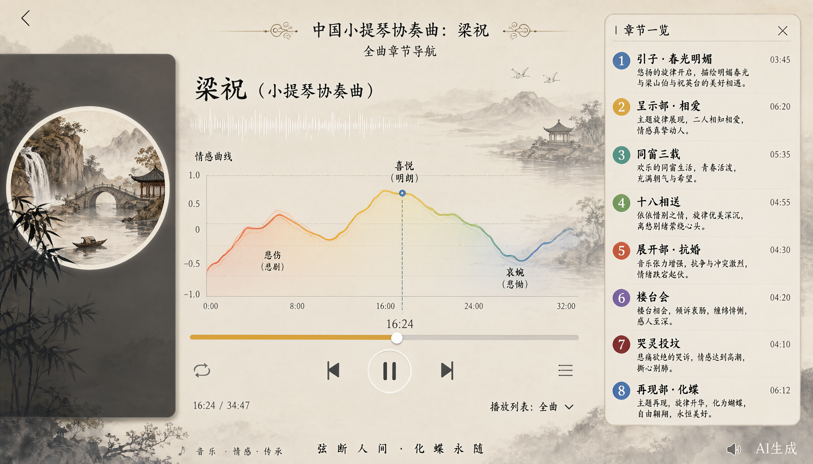
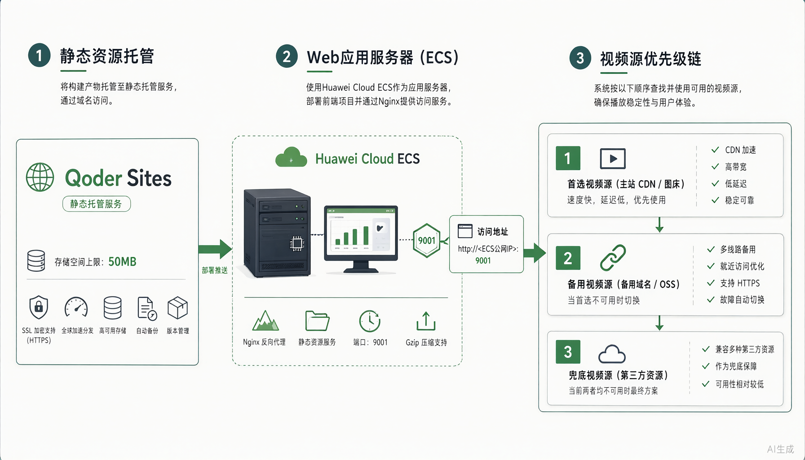
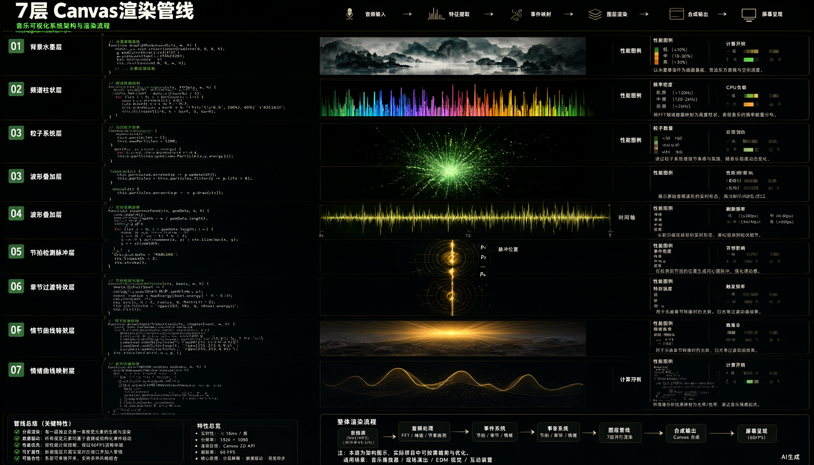

# 乐见 · 中国民族音乐赏析

> **v1.0.0** — 面向听障人群的音乐可视化翻译系统

面向听障人群的**音乐可视化翻译系统**，以小提琴协奏曲《梁祝》为案例，将音乐实时转化为水墨风格的多模态视觉语言。

Spring Boot 3 + Java 21 后端，Vite + ES Module 前端，国风水墨 UI。

## 截图

| 首页概览 | 播放器与可视化 |
|----------|----------------|
|  |  |

| 章节导航 | 移动端适配 |
|----------|------------|
|  |  |

| 技术架构 | 7 层渲染管线 |
|----------|--------------|
|  |  |

## 功能特性

- **实时音乐可视化**：音频特征 → 水墨笔画、墨滴粒子、光晕、旋律线、频谱粒子 6 层渲染
- **章节叙事系统**：8 个乐章章节自动匹配叙事文本 + 中英文双语切换
- **春夏秋冬 / 晨昏主题**：粒子形态随时段与季节变化（花瓣、墨雨、枯叶、雪花）
- **情感曲线**：进度条上方叠加实时情感强度可视化
- **触觉反馈**：Web Vibration API 将节拍转化为移动端振动
- **暗色模式**：CSS 变量 + 手动切换 + localStorage 持久化
- **移动端手势**：滑动调亮度/音量、双击快进/退、长按切倍速
- **工具栏自动隐藏**：乐见工具栏与控制条同步显示/隐藏，不遮挡画面
- **无障碍**：ARIA 标注 + 键盘导航 + 高对比度模式

## 技术栈

| 层 | 技术 |
|---|------|
| 后端 | Java 21, Spring Boot 3.2.5, Maven |
| 前端构建 | Vite 6, Terser, ES Module |
| 前端 | HTML5 Canvas, Web Audio API, Web Worker |
| 测试 | Vitest (42 tests) |
| 部署 | 单 JAR, 内嵌静态资源 |

## 项目结构

```
vedioWeb/
├── index.html / player.html      # Vite 入口 (HTML)
├── styles.css                    # 源码 CSS
├── js/                           # ES Module 源码 (12 files)
│   ├── event-bus.js              # 发布/订阅事件总线
│   ├── main-loop.js              # 统一 rAF 调度器
│   ├── music-analyzer.js         # 音频分析 (主线程)
│   ├── audio-worker.js           # 音频特征提取 (Web Worker)
│   ├── visual-translator.js      # 视觉翻译引擎 (6 层 Canvas)
│   ├── narrative-engine.js       # 章节叙事 + 双语
│   ├── haptic-engine.js          # 触觉反馈
│   ├── emotion-curve.js          # 情感曲线
│   ├── touch-gestures.js         # 移动端手势
│   ├── app.js                    # 粒子特效 + 加载动画
│   ├── player-main.js            # 播放页控制器 (入口)
│   └── index.js                  # 首页入口
├── public/                       # 静态资源 (原样复制到构建输出)
│   ├── media/                    # 视频、封面图
│   └── logo/                     # 图标、SVG
├── tests/                        # Vitest 单元测试
├── package.json                  # 前端依赖
├── vite.config.js                # Vite 构建配置 (Spring Boot 产物)
├── vite.deploy.config.js         # Vite 构建配置 (Qoder Sites 静态部署)
├── deploy/                       # 部署暂存 (gitignore): public/ 裁剪资源 + web/ 构建产物
├── pom.xml                       # Maven 配置 (含 frontend-maven-plugin)
└── src/main/java/                # Spring Boot 后端
```

## 快速开始

### 前提条件

- JDK 21+
- Maven 3.9+
- Node.js 20+（本地前端开发时需要；Maven 构建会自动下载）

### 本地开发

```bash
# 安装前端依赖
npm install

# 启动 Vite 开发服务器 (HMR)
npm run dev

# 运行单元测试
npm test
```

### 生产构建

```bash
# 方式一：Maven 一键构建（自动执行 npm install + vite build）
mvn clean package -DskipTests

# 方式二：单独前端构建
npm run build
```

构建产物输出到 `src/main/resources/static/`，由 Spring Boot 直接交付。

### 启动服务（本地开发）

```bash
# 前台运行（调试用）
java -jar target/music-app-1.0.0.jar
```

浏览器访问 `http://localhost:9000`。

> **服务器部署请使用下方 `seemusic` 命令**，不要用 `nohup ... &` 手工管理进程。端口、PID、日志、重启、停止由脚本统一处理，且启动后会打印实测监听端口。

## 服务器部署（seemusic 一键全流程）

> **重要前提**：GitHub 仓库不含 `target/`、`src/main/resources/static/` 与 `*.mp4`，clone 下来是纯源码，**没有可直接运行的 JAR**。必须先构建，且 `mvn clean package` 会通过 `frontend-maven-plugin` 下载 Node v20.18.0 并执行 `npm install`，**构建依赖外网**。视频需提前上传到 `/opt/video/liangzhu.mp4`。

### 1. 环境准备

```bash
# Debian / Ubuntu
sudo apt update && sudo apt install -y openjdk-21-jdk maven git curl
# RHEL / Fedora / Rocky
# sudo dnf install -y java-21-openjdk-devel maven git curl

java -version && mvn -v      # 需 JDK 21+、Maven 3.9+
```

### 2. 拉取代码（视频已提前上传）

```bash
cd /opt
sudo git clone https://github.com/JasonR-student/music-app.git music-app
cd /opt/music-app
ls -lh /opt/video/liangzhu.mp4        # 确认视频在位
# 若目录权限不足：sudo chown -R "$USER" /opt/music-app /opt/video
```

### 3. 注册全局命令（仅一次）

```bash
sudo chmod +x /opt/music-app/scripts/seemusic.sh
sudo ln -sfn /opt/music-app/scripts/seemusic.sh /usr/local/bin/seemusic
seemusic help
```

脚本在仓库内，通过软链注册；`seemusic pull` 后脚本自动更新，无需重装。

### 4. 一键构建 + 启动

```bash
seemusic up
```

`up` 依次执行前置检查 → `mvn clean package -DskipTests` → 校验 JAR 与 Vite 双入口产物 → 启动 → 等待首页返回 HTTP 200 → **打印实测 LISTEN 行**：

```
[ OK ] 启动成功
       LISTEN 0 0.0.0.0:9000 0.0.0.0:* users:(("java",pid=24817,fd=...))
  实际监听端口 : 9000  (来源 .seemusic.conf: default)
  PID          : 24817
  访问地址     : http://127.0.0.1:9000/   (公网 http://<服务器IP>:9000/)
  日志         : /opt/music-app/run/app.log
  防火墙       : 需放行 TCP 9000
```

端口来自 `ss` 实测，不是简单回显配置值。**防火墙/云安全组必须放行该端口**（`sudo ufw allow 9000/tcp`），否则本机 LISTEN 成功但外网不可达。

### 5. 命令表

| 命令 | 作用 |
|------|------|
| `seemusic up` | 一键：检查 → 构建 → 启动 → 验证 → 打印端口 |
| `seemusic build` | 仅构建（`mvn clean package`，自动 `vite build`） |
| `seemusic start` | 启动后台服务并验证监听 |
| `seemusic stop` | 停止服务（SIGTERM，15 秒超时后 SIGKILL） |
| `seemusic restart` | `stop` + `start`，读取最新端口配置 |
| `seemusic status` | 运行状态、实测 LISTEN 行、实际端口与配置端口 |
| `seemusic port 8081` | 把端口写入 `.seemusic.conf`，`restart` 后生效 |
| `seemusic logs -f` | 持续跟踪 `run/app.log`（Ctrl-C 不停止服务） |
| `seemusic logs 100` | 查看最近 100 行日志 |
| `seemusic pull` | `git pull --ff-only`（工作区有改动会中止） |
| `seemusic help` | 完整帮助与退出码 |

典型流程：

```bash
seemusic status
seemusic port 8081 && seemusic restart     # 改端口并生效，记得同步放行 8081
seemusic pull && seemusic up               # 更新代码后重新构建启动
seemusic stop
```

### 端口与配置文件

- `application.yml` 的 `server.port: 9000` 是**默认值**；脚本启动时用 `--server.port=N` 注入，不修改源码。
- `seemusic port <N>` 写入项目根 `.seemusic.conf` 的 `PORT=N`（已加入 `.gitignore`），因此**不会污染 git**，`git pull` 不冲突；`restart` 后保留。
- 配置丢失或非法时回落 9000，`status` 会标注来源 `conf` / `default`。
- 服务运行中改端口后，`status` 会同时显示「实际端口（当前）」与「配置端口（下次启动）」，避免误判。
- `run/` 存放 `seemusic.pid`、`app.log`、`build.log`（均已忽略）。PID 文件含 `/proc/<pid>/stat` 的 starttime，用于防止 PID 复用导致误杀；校验不通过时只清理 PID 文件，绝不 kill 无关进程。

### 退出码

`0` 成功 ｜ `1` 参数错 ｜ `2` 前置不满足 ｜ `3` 端口被其他进程占用 ｜ `4` 状态冲突 ｜ `5` 监听验证失败 ｜ `6` 构建失败 ｜ `7` pull 失败。`seemusic status` 在服务未运行时返回 `4` 并打印 `STOPPED`，属正常查询结果。

### 构建失败排查

脚本会把完整构建输出写到 `run/build.log`，失败时自动打印尾部 80 行。三类常见原因：

1. 服务器无法访问 `nodejs.org`（国内常见）→ 在 `pom.xml` 的 `frontend-maven-plugin` 配 `<nodeDownloadRoot>` 指向镜像；
2. 无法访问 npm registry → 配置 npm 镜像源；
3. 完全离线 → 预置 `node/` 运行时与 npm 依赖缓存。

> 构建脚本只做版本与连通性提示，**外网探测失败仅告警不阻断**，是否失败由 Maven 实际结果判定。

## 视频源优先级

`player.html` 按顺序尝试下列源，前一个 404/失败时浏览器自动回落到下一个：

| 顺序 | 源 | 适用场景 |
|------|-----|----------|
| 1 | `/media/video/liangzhu.mp4` | 自建 Spring Boot：映射到 `video.storage-dir`（默认 `/opt/video`），资源处理器原生支持 Range |
| 2 | `media/liangzhu.mp4` | 站点自带视频（本地开发、自建静态服务器） |
| 3 | 远程直链 | Qoder Sites 静态托管：包体不含视频，整包约 1 MiB |

`<video>` 上的 `crossorigin="anonymous"` 不能省略，否则 Web Audio 从跨域媒体只能读到静音、可视化整体失效；相应地**远程源必须返回 `Access-Control-Allow-Origin`**。Spring 端已在 `WebConfig.addCorsMappings` 为 `/media/video/**` 与 `/api/video/**` 放开跨域（GET/HEAD）。

## 华为云 ECS 提供视频源（推荐）

码率要与带宽匹配：全画质原片约 1.45 Mbps（305 MiB / 28 分钟），压缩版约 210 kbps（43.7 MiB）。ECS 带宽常见 1–5 Mbps，**对外建议提供压缩版**，原片留作下载或内网自建。

```bash
# 1. 本地：压缩出对外版本（两遍编码 640x360 / 24fps / H.264 140kbps + AAC 72kbps，+faststart）
ffmpeg -i public/media/liangzhu.mp4 -vf scale=640:360 -r 24 \
  -c:v libx264 -b:v 140k -pass 1 -an -f null NUL
ffmpeg -i public/media/liangzhu.mp4 -vf scale=640:360 -r 24 \
  -c:v libx264 -b:v 140k -pass 2 -c:a aac -b:a 72k -movflags +faststart \
  deploy/liangzhu.mp4

# 2. 本地：上传到 ECS
scp deploy/liangzhu.mp4 root@<ECS_IP>:/opt/video/liangzhu.mp4
```

`/etc/nginx/conf.d/video.conf`：

```nginx
server {
    listen 443 ssl http2;
    server_name video.example.com;                    # 换成你的域名

    ssl_certificate     /etc/nginx/cert/video.example.com.pem;
    ssl_certificate_key /etc/nginx/cert/video.example.key;

    location /video/ {
        alias /opt/video/;
        types { video/mp4 mp4; }

        add_header Access-Control-Allow-Origin  *                  always;
        add_header Access-Control-Allow-Methods "GET, HEAD, OPTIONS" always;
        add_header Accept-Ranges               bytes               always;
        add_header Cache-Control               "public, max-age=604800" always;
        # Range 请求由 nginx 静态模块原生支持，无需额外配置
    }
}
```

直链即 `https://video.example.com/video/liangzhu.mp4`，把它填进 `player.html` 的第 3 个 `<source>` 后 `npm run build:deploy`。

前置条件与验证：

- **备案**：中国大陆地域 ECS 用域名对外提供 Web 服务需完成 ICP 备案；未备案可改用中国香港/新加坡地域。证书无法签给 IP，而 Qoder Sites 是 HTTPS 站点，用 `http://IP` 会被当混合内容拦截 —— 所以域名 + 证书是必需的。
- **证书**：华为云 SSL 证书服务可申请免费 DV 证书，或用 `acme.sh` 签 Let's Encrypt；安全组放行 443。
- **三项验证**（全部通过才可用）：

```bash
curl -sI -H "Origin: https://<你的站点域名>" https://video.example.com/video/liangzhu.mp4 \
  | grep -i "^HTTP/\|access-control-allow-origin\|content-type\|accept-ranges\|content-disposition"
curl -s -o /dev/null -w "%{http_code} %{speed_download} B/s\n" \
  -r 0-2097151 https://video.example.com/video/liangzhu.mp4
```

期望：`200`/`206`、`Access-Control-Allow-Origin: *`、`Content-Type: video/mp4`、`Accept-Ranges: bytes`，**且不能出现 `Content-Disposition: attachment`**；下载速率需明显高于视频码率（210 kbps ≈ 26 KB/s）。

## Qoder Sites 静态部署

```bash
npm run build:deploy     # 产物输出到 deploy/web/，即托管目录
```

`deploy/public/` 只放图标、封面与海报图（视频不进托管包），`deploy/web/` 整包约 1 MiB。

> 为什么视频不进托管包：Qoder Sites 单文件上限 50 MiB，且产物上传是**单次 PUT、限时 45 秒**（约需 ≥1 MB/s 稳定上行）。44 MiB 的包在上行不足的网络下传不完，移出视频后包体降到 ~1 MiB。
>
> 为什么不用 GitHub Release 直链：实测（校园网）资源下载仅 9.7 KB/s 且间歇 504，响应还缺 `Access-Control-Allow-Origin`、`Content-Type` 为 `application/octet-stream`、并带 `Content-Disposition: attachment` —— 配 `crossorigin` 时必然加载失败。Release 仅作仓库备份保留。

## 配置

| 配置项 | 默认值 | 说明 |
|--------|--------|------|
| `server.port` | 9000 | 服务端口默认值；服务器部署由 `seemusic port <N>` 写入 `.seemusic.conf` 并以 `--server.port=N` 注入，**不修改本文件** |
| `video.storage-dir` | /opt/video | 视频文件存储目录；`seemusic` 自动读取该值检查视频是否就位 |

视频命名规则：`{name}.mp4` → API `/api/video/{name}`。运行时产物 `.seemusic.conf`、`run/` 的说明见「服务器部署」章节。

## API

| 接口 | 说明 |
|------|------|
| `GET /` | 首页 |
| `GET /player.html` | 视频播放页 |
| `GET /api/video/{name}` | 视频流（支持 HTTP Range） |

## 性能优化

- 3 个独立 rAF 循环合并为 1 个统一调度器（MainLoop）
- 音频特征提取移至 Web Worker，主线程零阻塞
- 粒子回收使用 swap-and-pop O(1) 替代 Array.splice O(n)
- Canvas 渲染节流：稳态 30fps，节拍时 60fps
- 粒子数量根据帧间隔自适应调整
- Vite 打包 + Terser 压缩：JS ~58KB → ~37KB (gzip ~14KB)

## 停止服务与验证清单

停止与重启统一使用 `seemusic stop` / `seemusic restart`，无需再 `ps aux | grep music-app` 手工找 PID。

部署完成后建议逐项验证：

```bash
seemusic up                    # 输出应包含实测 LISTEN 行与端口/PID/地址/日志
seemusic status                # RUNNING + LISTEN 行 + HTTP / -> 200
curl -I http://127.0.0.1:9000/                                  # 首页 200
curl -I -r 0-1023 http://127.0.0.1:9000/media/video/liangzhu.mp4   # 视频流 206 + Content-Range
seemusic port 8081 && seemusic restart                        # status 应显示实际端口 8081
seemusic stop                  # 端口释放；seemusic status 显示 STOPPED
```

### 已知限制

| 限制 | 说明 |
|------|------|
| 构建依赖外网 | `mvn clean package` 每次会下载 Node v20.18.0 与 npm 依赖；离线服务器需预置镜像或缓存 |
| `nohup` + PID 非守护进程 | **不开机自启、崩溃/OOM 后不自动拉起**；需要该能力应改用 systemd unit（当前方案按轻量运维选择，不含 systemd） |
| 端口需双重放行 | 脚本只保证本机 LISTEN；云服务器安全组/防火墙必须同步放行，改端口后要放行新端口 |
| 视频文件不入库 | `*.mp4` 被 `.gitignore` 排除，需单独上传到 `video.storage-dir`（默认 `/opt/video`）；缺失时播放页首选源 404 并回落远程直链 |
| JAR 体积 | 若本地 `public/media/` 存在 mp4，Vite 会复制进 `static/` 一起打包（本地曾出现 629 MB JAR）；`seemusic build` 会在 JAR 超过 100 MB 时告警 |
